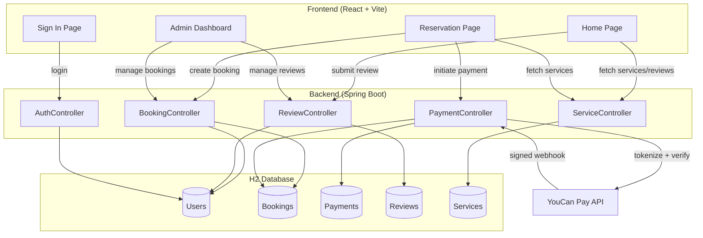
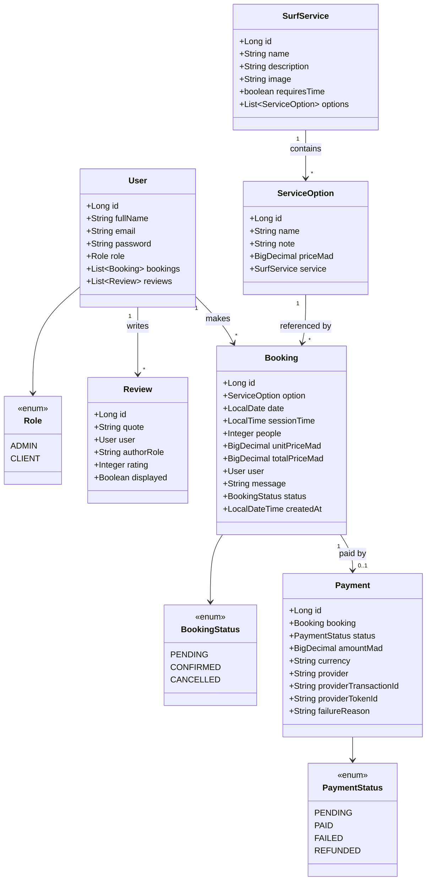
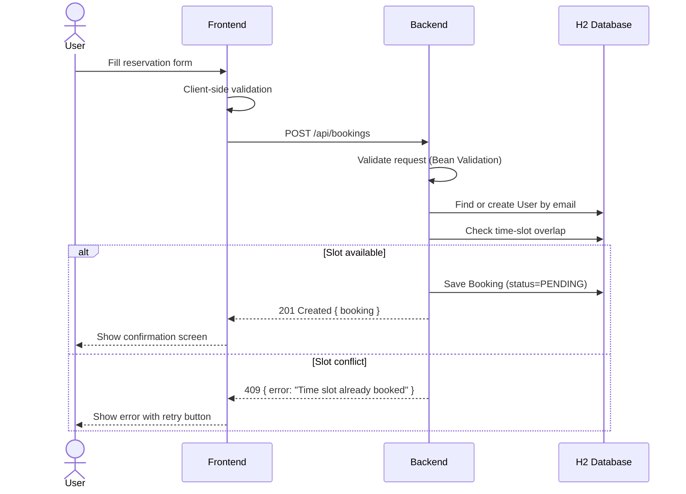
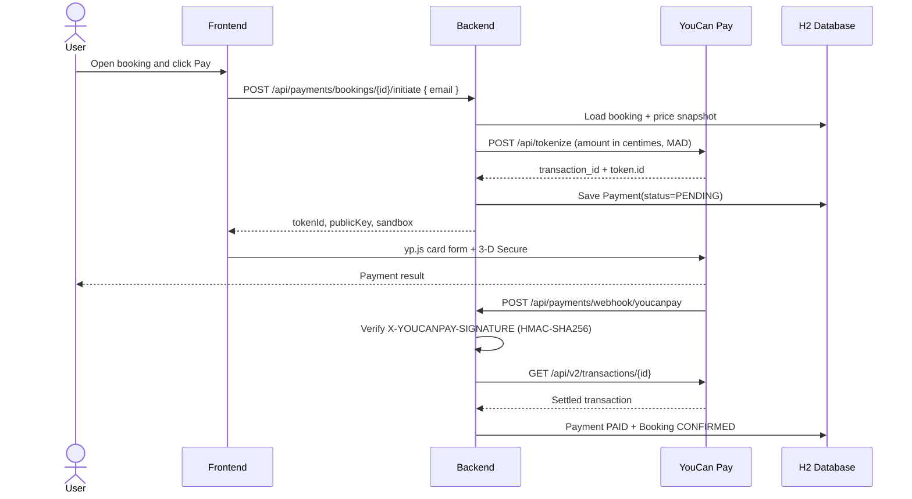
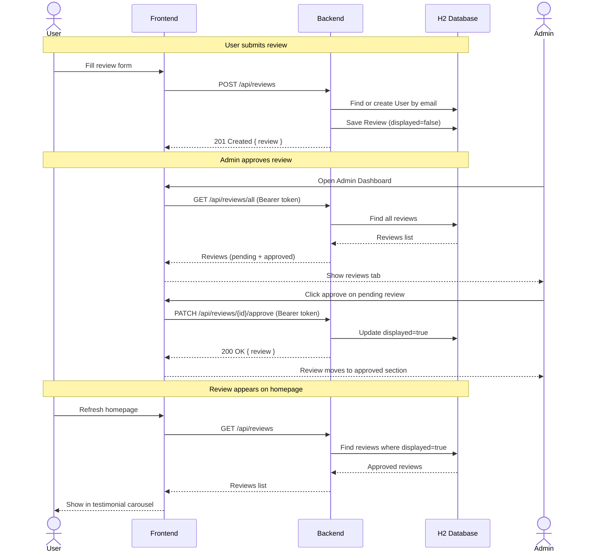
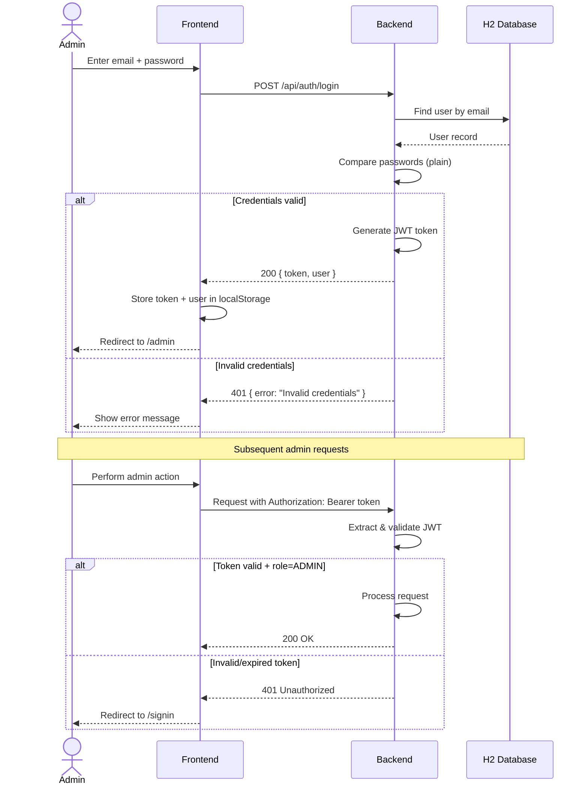
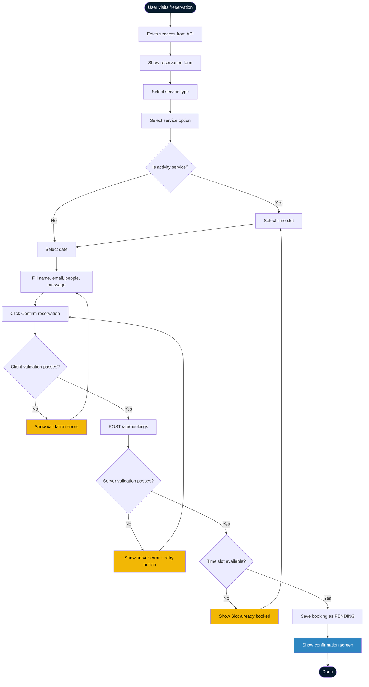
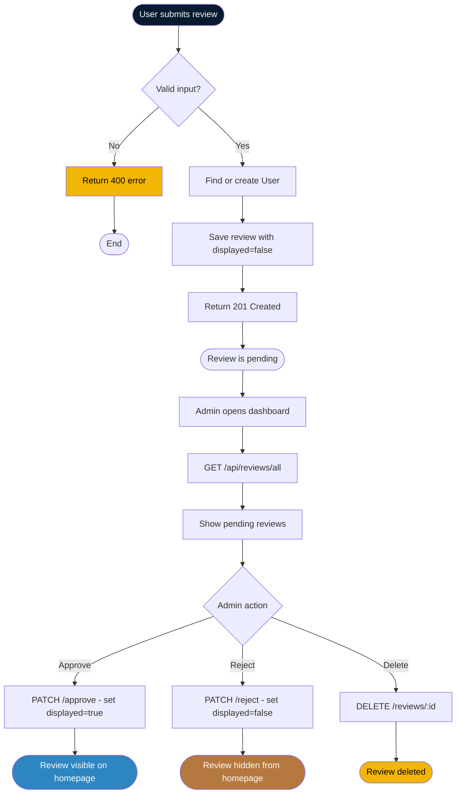

# ZIGGIZ Surf Co.

<p align="center">
  
</p>

A full-stack **surf-tourism platform** with a React frontend and Spring Boot backend — booking management, review system, YouCan Pay card payments, and an admin dashboard with JWT authentication.

---

## Tech Stack

| Layer               | Tool                        | Purpose                                       |
| ------------------- | --------------------------- | --------------------------------------------- |
| **Frontend**  | React 19 + Vite 8           | Component architecture, instant HMR           |
| **Styling**   | Tailwind CSS v4             | Utility classes + design tokens via`@theme` |
| **Motion**    | Framer Motion 13            | Scroll-linked transforms, reveals, loader     |
| **Scrolling** | Lenis                       | Inertial smooth scrolling                     |
| **Routing**   | React Router 7              | Client-side page routing                      |
| **Backend**   | Spring Boot 4.1.1 + Java 17 | REST API, JPA, JWT auth                       |
| **Database**  | H2 (in-memory)              | Fast dev database, auto-seeded on boot        |
| **ORM**       | Spring Data JPA + Hibernate | Entity management, lazy loading               |
| **Auth**      | JWT (jjwt 0.12.6)           | Token-based admin authentication              |
| **Payments**  | YouCan Pay API v2           | MAD card payments + signed webhooks           |
| **Icons**     | lucide-react                | Tree-shakeable icon set                       |

---

## Architecture Overview



---

## Class Diagram



---

## Sequence Diagram — Booking Flow



---

## Sequence Diagram — Payment Flow



---

## Sequence Diagram — Review Flow



---

## Sequence Diagram — Authentication Flow



---

## Activity Diagram — Reservation Process



---

## Activity Diagram — Review Approval Process



---

## API Endpoints

### Public

| Method   | Path                | Description                      |
| -------- | ------------------- | -------------------------------- |
| `GET`  | `/`               | Health check                     |
| `POST` | `/api/auth/login` | Admin login → JWT token         |
| `GET`  | `/api/services`   | List all services with options   |
| `POST` | `/api/bookings`   | Create a booking                 |
| `GET`  | `/api/reviews`    | Get displayed (approved) reviews |
| `POST` | `/api/reviews`    | Submit a review (starts hidden)  |

### Payments (public, protected by booking email/webhook signature)

| Method   | Path                                      | Description                                      |
| -------- | ----------------------------------------- | ------------------------------------------------ |
| `POST` | `/api/payments/bookings/{id}/initiate`  | Tokenize a booking payment with YouCan Pay       |
| `GET`  | `/api/payments/bookings/{id}?email=...` | Get payment status for the booking owner         |
| `POST` | `/api/payments/webhook/youcanpay`       | Receive signed YouCan Pay transaction events     |

### Admin (requires `Authorization: Bearer <token>`)

| Method     | Path                              | Description                         |
| ---------- | --------------------------------- | ----------------------------------- |
| `GET`    | `/api/bookings`                 | List all bookings                   |
| `GET`    | `/api/bookings/{id}`            | Get booking by ID                   |
| `GET`    | `/api/bookings/status/{status}` | Filter bookings by status           |
| `PATCH`  | `/api/bookings/{id}/status`     | Update booking status               |
| `DELETE` | `/api/bookings/{id}`            | Delete a booking                    |
| `GET`    | `/api/reviews/all`              | List all reviews (including hidden) |
| `PATCH`  | `/api/reviews/{id}/approve`     | Approve review (displayed=true)     |
| `PATCH`  | `/api/reviews/{id}/reject`      | Hide review (displayed=false)       |
| `DELETE` | `/api/reviews/{id}`             | Delete a review                     |

**Admin credentials:** `admin@ziggiz.com` / `admin123`

---

## Online Payments (YouCan Pay)

The backend implements the server side of the YouCan Pay card flow for MAD
payments, and the React reservation page renders the browser card form. The
reservation form offers two payment methods — **Pay now by card** (the flow
below) and **Pay on arrival** (the booking stays `PENDING` and is settled in
cash at check-in; no payment record is created).

1. `POST /api/payments/bookings/{id}/initiate` with the booking email creates a
   YouCan Pay token. The amount is the booking price snapshot (unit price ×
   people), converted to centimes.
2. The frontend renders the card form with `yp.js` and completes 3-D Secure.
3. YouCan Pay calls `POST /api/payments/webhook/youcanpay`. The backend verifies
   the `X-YOUCANPAY-SIGNATURE` HMAC-SHA256 header, re-fetches the transaction
   from `GET /api/v2/transactions/{id}`, and checks the amount, currency and
   `order_id` before changing anything. In sandbox mode the transaction is read
   from the signed webhook body instead, because the v2 Transactions API only
   accepts live keys.
4. `transaction.paid` moves the payment to `PAID` and the booking to
   `CONFIRMED`; `transaction.failed` marks the payment `FAILED`; a refund marks
   it `REFUNDED` and cancels the booking.
5. The frontend never trusts the browser result: after `confirm()` resolves it
   polls `GET /api/payments/bookings/{id}?email=…` every 2s (60s cap) until the
   webhook has moved the payment to `PAID`, then shows the confirmation screen.

With `YOUCANPAY_SANDBOX=true`, tokenization uses
`https://youcanpay.com/sandbox/api/tokenize` and the backend expects sandbox
keys (`pri_sandbox_...` / `pub_sandbox_...`). Use the test cards from the
YouCan Pay sandbox documentation; live and sandbox keys cannot be mixed.

### Configuration

Set these environment variables before starting the backend:

| Variable                    | Description                                      |
| --------------------------- | ------------------------------------------------ |
| `YOUCANPAY_PRIVATE_KEY`   | Server API key (also used to verify webhooks)    |
| `YOUCANPAY_PUBLIC_KEY`    | Public key used by `yp.js` in the browser       |
| `YOUCANPAY_BASE_URL`      | Root API URL; defaults to `https://youcanpay.com` |
| `YOUCANPAY_SUCCESS_URL`   | Browser redirect after success                   |
| `YOUCANPAY_ERROR_URL`     | Browser redirect after failure                   |
| `YOUCANPAY_SANDBOX`       | `true` for the sandbox environment               |

Register the webhook once in the YouCan Pay dashboard (or `POST
/api/v2/webhooks`) with the events `transaction.paid`, `transaction.failed` and
`transaction.refunded`. The URL must be public HTTPS; local development needs a
tunnel such as ngrok or Cloudflare Tunnel.

### Seeded prices

Prices are stored per person on `ServiceOption.priceMad` and snapshotted onto
`Booking` when the booking is created. `null` means “price on request” and such
options cannot be paid online.

| Service       | Option                    | Price (MAD/person) |
| ------------- | ------------------------- | -----------------: |
| Quad Trips    | Sunset Dune Run           |                450 |
| Quad Trips    | Paradise Valley Ride      |                500 |
| Boat Trips    | Sunset Coast Cruise       |                600 |
| Boat Trips    | Snorkel & Hidden Coves    |                600 |
| Surf Lessons  | Grom Camp / Adult / Private | On request       |
| Surf Hostel   | Shared / Private / Surf & Stay | On request   |

---

## Getting Started

### Prerequisites

- Java 17+
- Node.js 18+
- npm

### Backend

```bash
cd backend
./mvnw spring-boot:run
# Runs on http://localhost:8080
```

### Frontend

```bash
cd frontend
npm install
npm run dev
# Runs on http://localhost:5173
```

### H2 Console

Access at `http://localhost:8080/h2-console` (JDBC URL: `jdbc:h2:mem:ziggizdb`, user: `sa`)

---

## Project Structure

```
surf-co/
├── backend/
│   ├── src/main/java/com/ziggiz/backend/
│   │   ├── BackendApplication.java          # Entry point
│   │   ├── config/
│   │   │   ├── CorsConfig.java              # CORS for localhost:5173
│   │   │   ├── JwtUtil.java                 # JWT generate/parse
│   │   │   ├── GlobalExceptionHandler.java  # Error handling
│   │   │   ├── DataSeeder.java              # Seeds admin + services
│   │   │   └── H2ConsoleConfig.java         # H2 web console
│   │   ├── model/
│   │   │   ├── User.java                    # User entity
│   │   │   ├── Booking.java                 # Booking entity
│   │   │   ├── SurfService.java             # Service entity
│   │   │   ├── ServiceOption.java           # Service option entity
│   │   │   ├── Review.java                  # Review entity
│   │   │   ├── Payment.java                 # Payment entity
│   │   │   ├── Role.java                    # ADMIN, CLIENT
│   │   │   ├── BookingStatus.java           # PENDING, CONFIRMED, CANCELLED
│   │   │   └── PaymentStatus.java           # PENDING, PAID, FAILED, REFUNDED
│   │   ├── payment/
│   │   │   ├── PaymentGateway.java           # Provider interface (mockable)
│   │   │   ├── YouCanPayGateway.java         # Tokenize + transaction API
│   │   │   ├── YouCanPayProperties.java      # payment.youcanpay.* config
│   │   │   └── PaymentException.java         # HTTP-status error
│   │   ├── controller/
│   │   │   ├── AuthController.java          # POST /api/auth/login
│   │   │   ├── BookingController.java       # Booking CRUD
│   │   │   ├── ReviewController.java        # Review CRUD + approve/reject
│   │   │   ├── ServiceController.java       # Service listing
│   │   │   ├── PaymentController.java       # Payment initiate/status/webhook
│   │   │   ├── HomeController.java          # Health check
│   │   │   └── DebugController.java         # Debug endpoint
│   │   ├── service/
│   │   │   ├── BookingService.java          # Booking business logic
│   │   │   ├── ReviewService.java           # Review business logic
│   │   │   ├── PaymentService.java          # Payment business logic
│   │   │   └── SurfServiceService.java      # Service business logic
│   │   ├── repository/
│   │   │   ├── UserRepository.java
│   │   │   ├── BookingRepository.java
│   │   │   ├── SurfServiceRepository.java
│   │   │   ├── ServiceOptionRepository.java
│   │   │   ├── PaymentRepository.java
│   │   │   └── ReviewRepository.java
│   │   └── dto/
│   │       ├── AuthRequest.java / AuthResponse.java
│   │       ├── BookingRequest.java / BookingResponse.java
│   │       ├── PaymentInitiateRequest.java / PaymentInitiateResponse.java
│   │       ├── PaymentResponse.java
│   │       ├── ReviewRequest.java / ReviewResponse.java
│   │       └── ServiceResponse.java / ServiceOptionResponse.java
│   └── src/main/resources/
│       └── application.properties
├── frontend/
│   ├── src/
│   │   ├── App.jsx                          # Routes: /, /reservation, /signin, /admin
│   │   ├── main.jsx                         # Entry: BrowserRouter + AuthProvider + I18nProvider
│   │   ├── index.css                        # Design tokens, fonts, keyframes
│   │   ├── pages/
│   │   │   ├── Home.jsx                     # Landing page composition
│   │   │   ├── Reservation.jsx              # Booking form + payment method choice
│   │   │   ├── SignIn.jsx                   # Admin login
│   │   │   └── AdminDashboard.jsx           # Manage bookings + reviews
│   │   ├── components/
│   │   │   ├── Hero.jsx                     # Scroll-linked pinned hero
│   │   │   ├── SurfScene.jsx                # Image cross-fade engine
│   │   │   ├── Header.jsx                   # Top nav + menu trigger
│   │   │   ├── TopBar.jsx                   # Announcement marquee
│   │   │   ├── Ticker.jsx                   # Guides carousel
│   │   │   ├── Lessons.jsx                  # Services section
│   │   │   ├── Pricing.jsx                  # Prices & packages (from client rate sheets)
│   │   │   ├── HoverBanner.jsx              # Expandable panel
│   │   │   ├── Stats.jsx                    # Animated KPIs
│   │   │   ├── Testimonials.jsx             # Reviews carousel + form
│   │   │   ├── PaymentForm.jsx              # YouCan Pay card form (yp.js)
│   │   │   ├── Footer.jsx                   # Contact + map + social
│   │   │   ├── MenuOverlay.jsx              # Full-screen nav
│   │   │   ├── Loader.jsx                   # Intro loading curtain
│   │   │   ├── LanguageSwitcher.jsx         # EN/FR/AR selector
│   │   │   ├── Logo.jsx                     # Brand wordmark
│   │   │   ├── RevealText.jsx               # Text animations
│   │   │   └── UI.jsx                       # Shared primitives
│   │   ├── context/
│   │   │   └── AuthContext.jsx              # JWT auth state
│   │   ├── hooks/
│   │   │   └── useLenis.js                  # Smooth scroll
│   │   ├── lib/
│   │   │   ├── api.js                       # API client (fetch + timeout)
│   │   │   ├── validate.js                  # Form validation
│   │   │   └── motion.js                    # Framer Motion presets
│   │   └── i18n/
│   │       ├── I18nContext.jsx              # Language context (EN/FR/AR)
│   │       └── translations.js              # All translation strings
│   └── public/
│       └── images/                          # Photography assets
└── README.md
```

---

## Design System

Tokens in `frontend/src/index.css`:

| Token                       | Value                     | Use              |
| --------------------------- | ------------------------- | ---------------- |
| `sand`                    | `#060B12`               | Page background  |
| `ocean-deep`              | `#071B2E`               | Section surfaces |
| `ocean` / `ocean-light` | `#0F3D63` / `#2E86C1` | Brand blues      |
| `sun` / `coral`         | `#FFD23F` / `#F2B705` | CTAs, highlights |
| `clay`                    | `#B5793F`               | Hostel accent    |
| `ink` / `ink-soft`      | `#F5F5F0` / `#A8B0B8` | Text             |

**Typography:** Fraunces (display) + Plus Jakarta Sans (body). Cairo for Arabic.

---

## Internationalization

3 languages with full RTL support:

- **English** (en)
- **French** (fr)
- **Arabic** (ar) — auto-switches to RTL layout

---

## Deploying

### Frontend

```bash
cd frontend && npm run build
# Static dist/ folder — deploy to Vercel, Netlify, Cloudflare Pages, etc.
```

### Backend

```bash
cd backend && ./mvnw package
# JAR file in target/ — deploy to any Java host
```

---

## Notes

- H2 is in-memory — data resets on restart. Switch to PostgreSQL/MySQL for production.
- Passwords are stored in plain text. Add BCrypt hashing before going live.
- The `DataSeeder` creates an admin user and sample services on each boot.
- JWT secret is hardcoded in `application.properties`. Use environment variables in production.
- Booking rows do not duplicate customer or service data: customer fields are derived from `User`, and the service is derived from the selected `ServiceOption`. Prices are intentionally snapshotted on the booking so later price changes do not alter existing charges.
- Service and review list endpoints use JPA entity graphs to avoid N+1 queries.
- YouCan Pay webhook registration is manual and needs a public HTTPS URL; the backend only implements the receiver.
- The React card form (`yp.js`) is implemented: `frontend/index.html` loads
  `https://youcanpay.com/yp.js`, `PaymentForm.jsx` mounts the embedded form with
  the v3 `window.yp(publicKey).elements({ token, container })` API, and the page
  only treats a payment as successful after polling
  `GET /api/payments/bookings/{id}?email=…` for the webhook-driven `PAID`
  status (the browser result is never trusted).

---

<p align="center">
  <sub>Built with salt in the air — Ziggiz Surf Co.</sub>
</p>
