# 🏄 ZIGGIZ

<p align="center">
  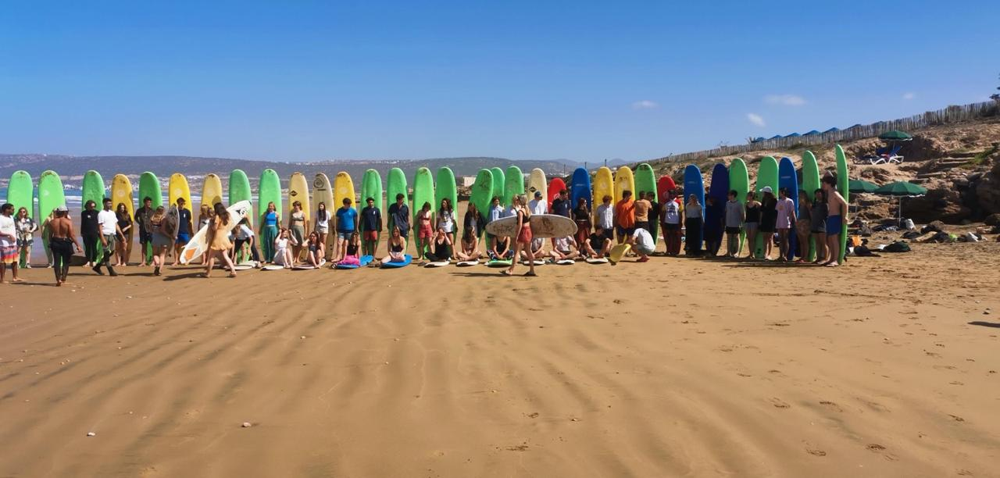
</p>

A production-ready **React + Vite + Tailwind CSS v4** marketing site for a boutique
surf-tourism outfit on the Atlantic coast — guided surf trips, lessons, quad &
boat adventures, and coastal hostel stays.

The site pairs an editorial, dark-ocean visual language (deep navy, sand black,
sun yellow) with motion-driven storytelling: a pinned hero whose photos
cross-fade as you scroll, a typewriter headline, ghost-word carousels, animated
counters, and buttery Lenis smooth scrolling.

---

## ✨ Highlights

|                                   |                                                                                             |
| --------------------------------- | ------------------------------------------------------------------------------------------- |
| 🌊**Scroll-linked hero**    | Pinned hero scene where photography cross-fades continuously with scroll progress           |
| ⌨️**Typewriter headline** | Rotating, color-coded words —*Surf* (white), *Beach* (blue), *Hostels* (clay brown)  |
| 📣**Announcement marquee**  | Thin auto-scrolling promo bar pinned at the very top of the page                            |
| 🎠**Ghost-word carousel**   | Oversized display type that swaps per slide, parallaxed by scroll                           |
| 🖼️**Lessons accordion**   | Hover-to-expand image panels for lessons, quad trips, boat trips & hostel                   |
| 🔢**Animated KPIs**         | Count-up numbers inside black glassmorphism cards over a photo backdrop                     |
| 💬**Review cards**          | Black-glass testimonial cards with staggered slide-up reveals                               |
| 🧭**Fullscreen menu**       | Staggered nav overlay with scroll locking and Esc/backdrop close                            |
| 📬**Booking modal**         | Accessible "Book a trip" dialog (stub submit — wire it to your backend)                    |
| 🖱️**Lenis smooth scroll** | Inertial, eased scrolling across the whole page                                             |
| ♿**Accessibility**         | Keyboard-navigable tabs/menu/modals, focus-visible rings,`prefers-reduced-motion` support |

---

## 🖼️ The experience, section by section

### Hero — first paddle

The full-viewport hero pins while you scroll: photography cross-fades through
surf, activities and hostel shots, a typewriter types and deletes
**SURF → BEACH → HOSTELS**, and a floating trip slider + stat card sit on a
glass backdrop.

<p>
  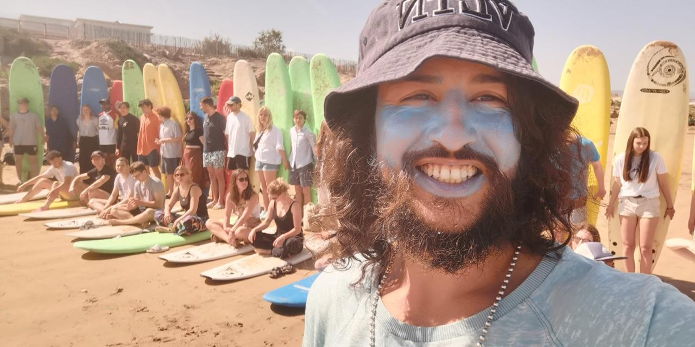
  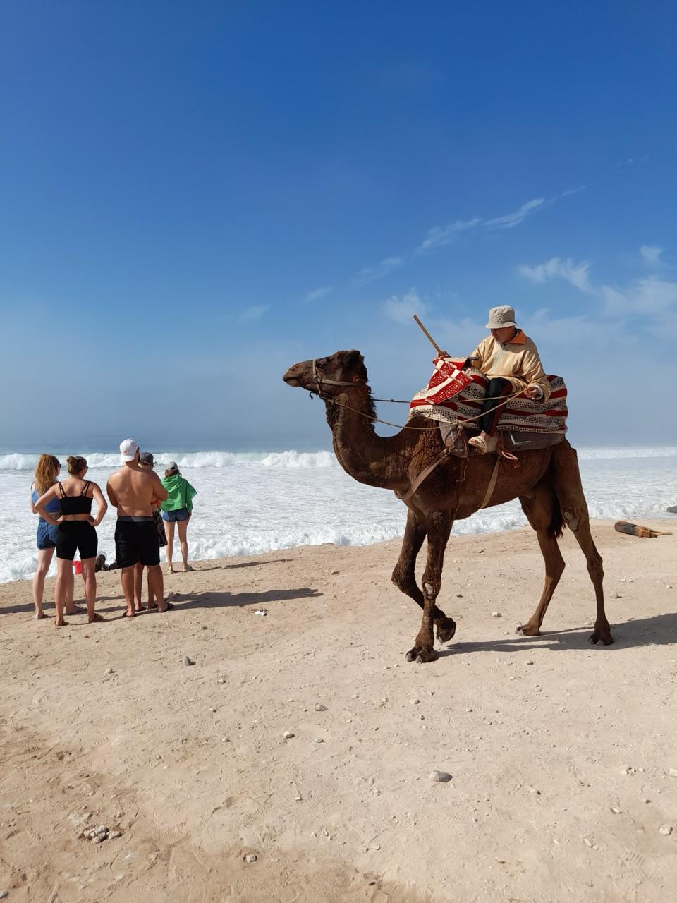
</p>

### Guides carousel

A scroll-parallaxed showcase of what the outfit offers, framed by oversized
ghost typography and a marquee of famous breaks.

<p>
  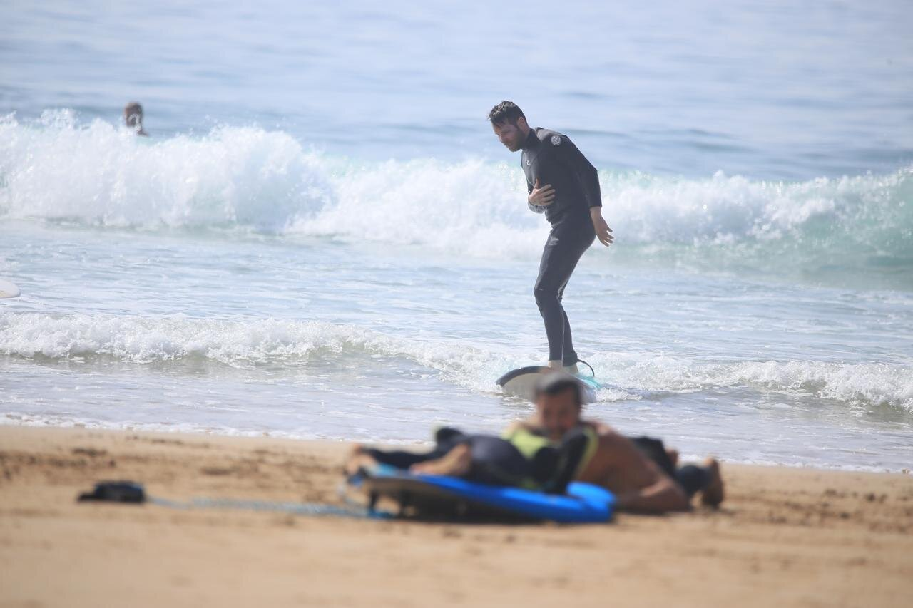
  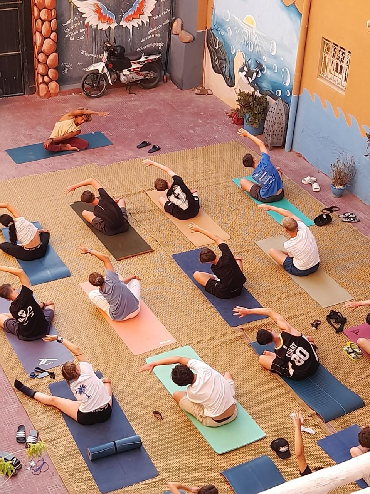
  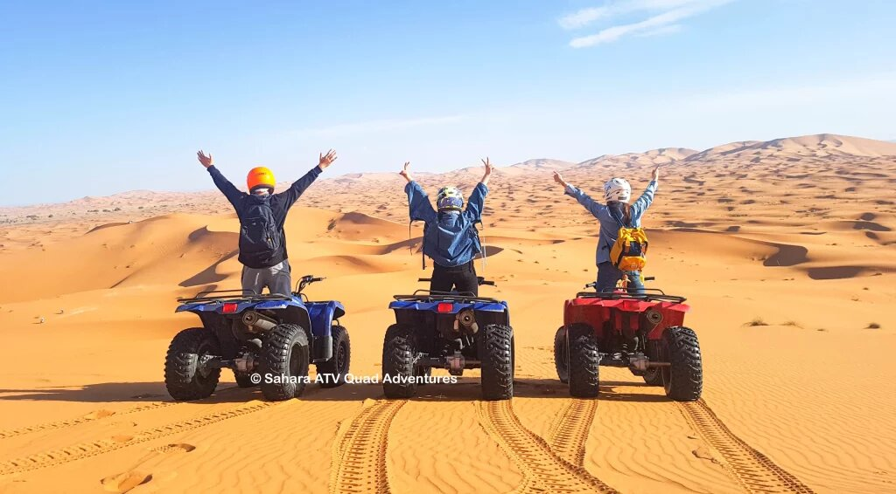
</p>

### Lessons & trips

Hover any panel to expand it — surf lessons for all ages, quad rides through
desert tracks, sunset boat cruises, and beds steps from the break.

<p>
  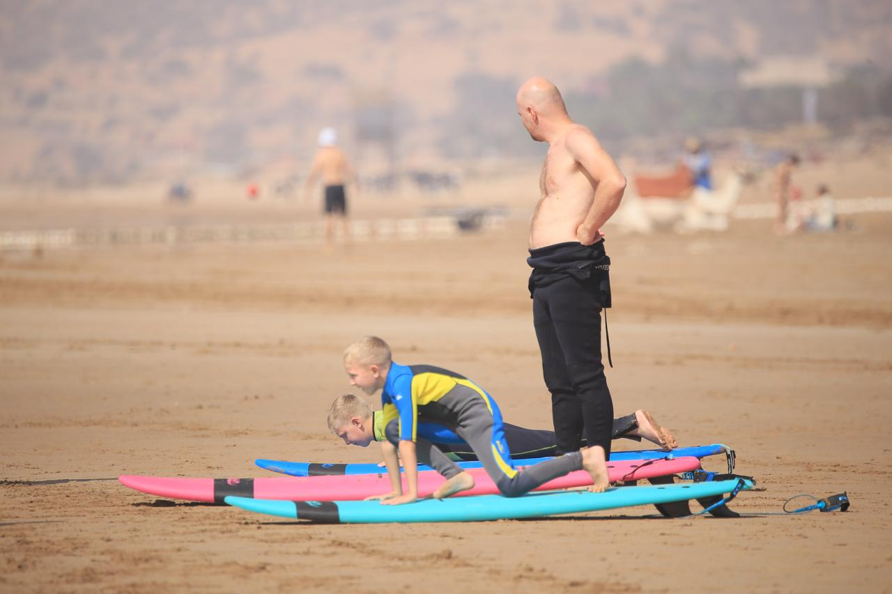
  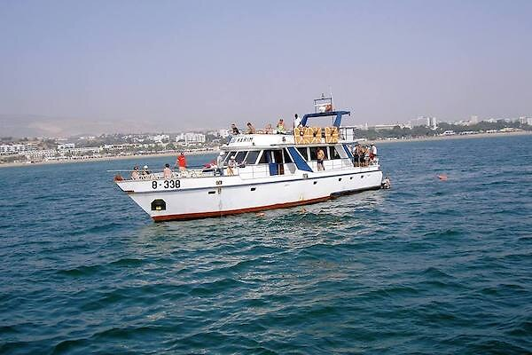
  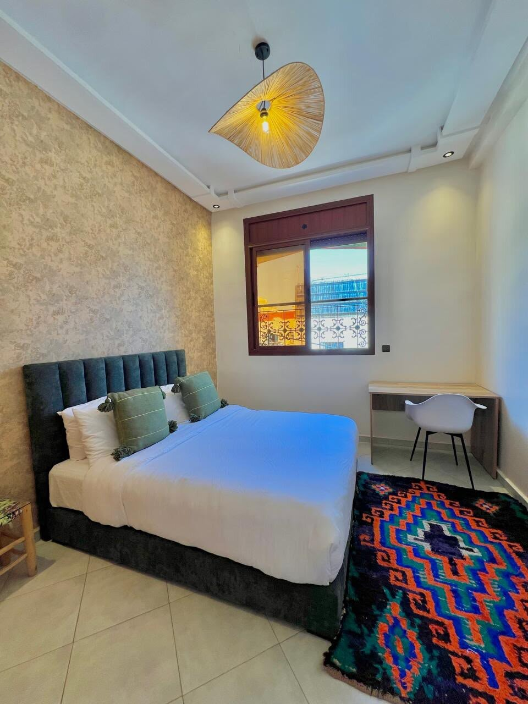
</p>

### By the numbers

KPI cards with count-up animation, black glassmorphism, and a sun-yellow hover
border — layered over an aerial shot of the coastline.

<p align="center">
  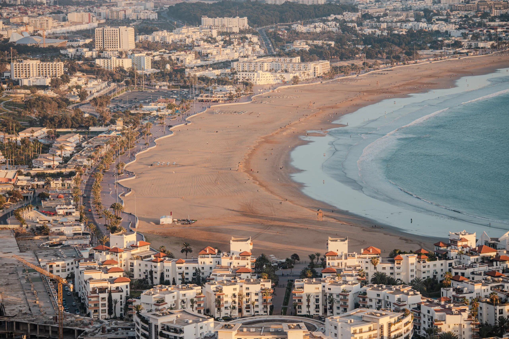
</p>

### What travelers say

Real words from guests, on frosted black cards over a Taghazout backdrop.

<p align="center">
  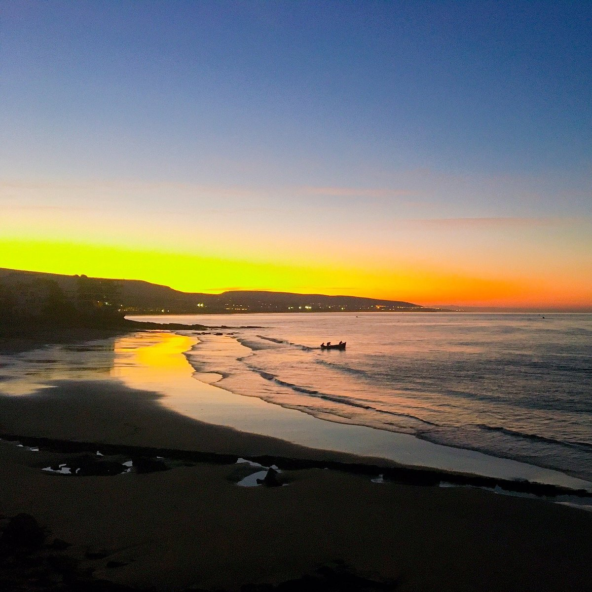
</p>

### More from the coast

<p>
  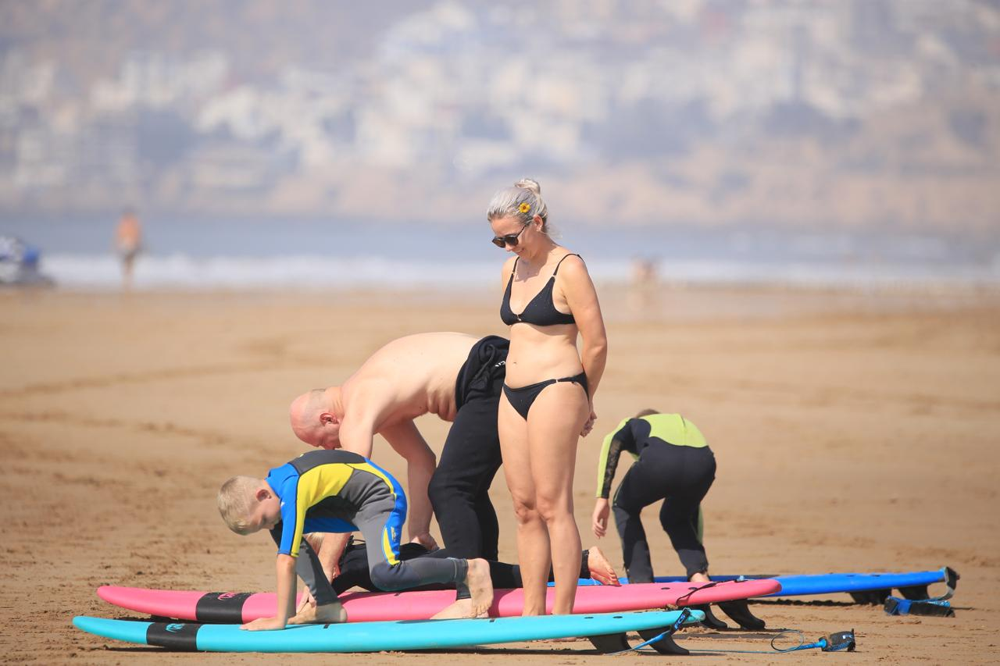
  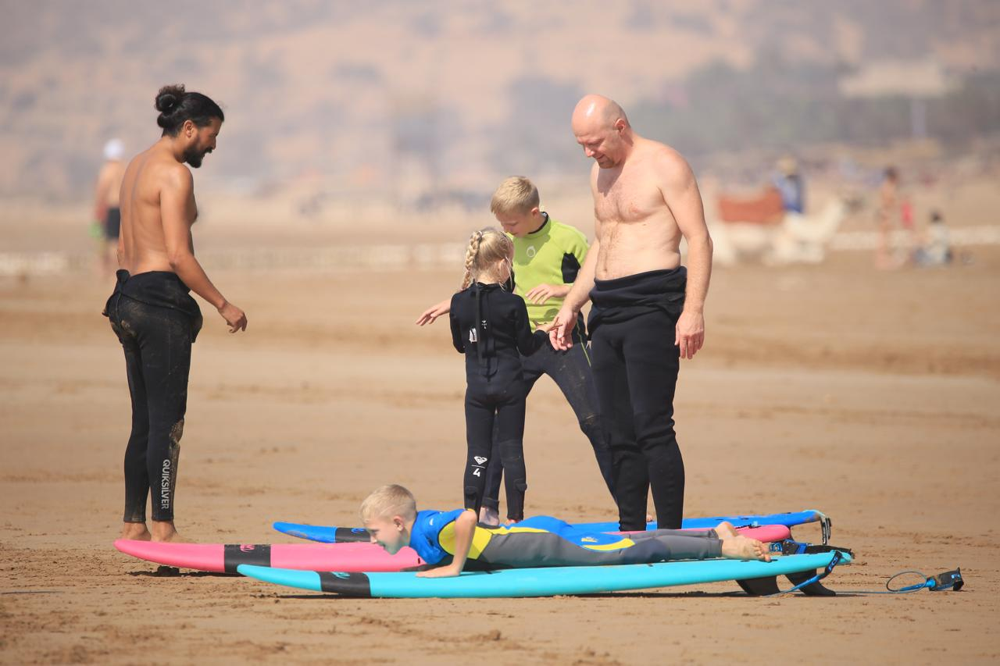
  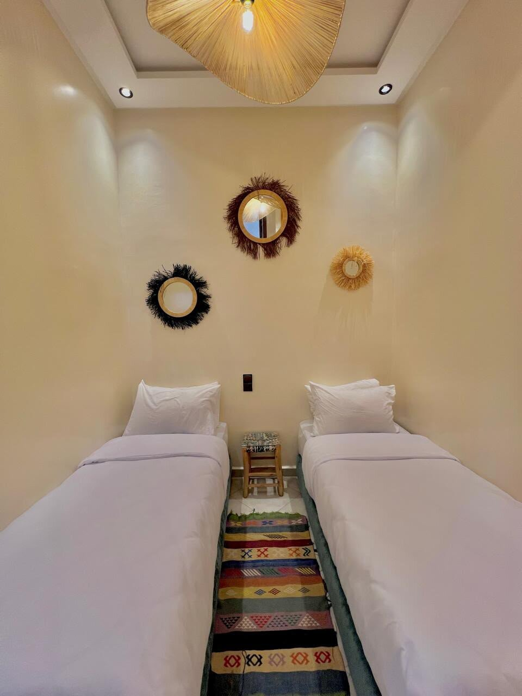
</p>

---

## 🧰 Stack

| Layer     | Tool                       | Why                                                  |
| --------- | -------------------------- | ---------------------------------------------------- |
| UI        | **React 19**         | Component architecture, hooks-driven state           |
| Build     | **Vite 8**           | Instant HMR, static production builds                |
| Styling   | **Tailwind CSS v4**  | Utility classes + design tokens via`@theme` in CSS |
| Motion    | **Framer Motion 13** | Scroll-linked transforms, reveals, modals, loader    |
| Scrolling | **Lenis**            | Inertial smooth scrolling + programmatic`scrollTo` |
| Icons     | **lucide-react**     | Crisp, tree-shakeable icon set                       |
| Lint      | **oxlint**           | Fast zero-config linting                             |

## 🎨 Design system

Tokens are declared once in [`src/index.css`](src/index.css) inside Tailwind's
`@theme` block and consumed as utilities everywhere (`bg-ocean-deep`,
`text-sun`, `rounded-[2rem]`, …).

| Token                       | Value                     | Use                             |
| --------------------------- | ------------------------- | ------------------------------- |
| `sand`                    | `#060B12`               | Page background (blue-black)    |
| `ocean-deep`              | `#071B2E`               | Section surfaces, modal, footer |
| `ocean` / `ocean-light` | `#0F3D63` / `#2E86C1` | Brand blues, accents            |
| `sun` / `coral`         | `#FFD23F` / `#F2B705` | CTAs, hover borders, highlights |
| `clay`                    | `#B5793F`               | "Hostels" headline accent       |
| `ink` / `ink-soft`      | `#F5F5F0` / `#A8B0B8` | Primary / secondary text        |

**Typography** — [Fraunces](https://fonts.google.com/specimen/Fraunces) for
display headings, [Plus Jakarta Sans](https://fonts.google.com/specimen/Plus+Jakarta+Sans)
for body copy.

---

## 🚀 Getting started

```bash
# 1. install
npm install

# 2. develop (http://localhost:5173)
npm run dev

# 3. lint
npm run lint

# 4. production build → /dist
npm run build

# 5. preview the build locally
npm run preview
```

## 📁 Project structure

```
src/
  App.jsx                 page composition + modal/menu state
  index.css               design tokens (@theme), fonts, keyframes, base styles
  components/
    TopBar.jsx            thin announcement marquee at the top of the page
    Hero.jsx              pinned hero: typewriter headline, trip slider, stat card
    SurfScene.jsx         scroll-linked photo cross-fade background
    Header.jsx            top nav (lessons link, book CTA, menu button)
    Ticker.jsx            guides carousel with ghost words + spots marquee
    Lessons.jsx           expandable panels: lessons, quads, boats, hostel
    HoverBanner.jsx       the accordion/expand panel primitive used by Lessons
    Stats.jsx             animated KPI band with black glass cards
    Testimonials.jsx      centered review cards on a photo backdrop
    Footer.jsx            CTA, nav columns, contact info, back-to-top
    ContactModal.jsx      booking dialog (stub submit, focus + Esc handling)
    MenuOverlay.jsx       fullscreen navigation overlay
    Loader.jsx            intro loading curtain
    RevealText.jsx        TypeWriter, StackedLines, WordReveal, WordFade
    UI.jsx                Eyebrow, PillButton, ArrowButton, Dots
    Photo.jsx             generative SVG "photo" tiles
    Logo.jsx              wordmark
  hooks/
    useLenis.js           Lenis setup, scroll lock, goTo/scrollToId helpers
  lib/
    motion.js             shared Framer Motion presets
public/
  images/
    surf/                 surf photography (surf1…surf10)
    activities/           yoga, quad & boat imagery
    hostels/              hostel imagery
    background/           aerial coastline backdrops (agadir, aghroud, taghazout)
```

## 🧭 Page anatomy

```
TopBar          ─ scrolling announcement strip
Hero            ─ pinned · scroll cross-fade · typewriter · CTAs
Ticker          ─ guides carousel · ghost words · spots marquee
Lessons         ─ hover-expand panels with deep links
Stats           ─ count-up KPIs on glass over Agadir aerial
Testimonials    ─ centered review cards over Taghazout
Footer          ─ CTA · sitemap · contact · back to top
```

## ♿ Accessibility & motion

- Menu, modal and hero panels are keyboard operable (`Tab`, `Enter`, `Esc`).
- `prefers-reduced-motion` disables animations, marquees and smooth scroll.
- Decorative imagery is `alt=""`; meaningful imagery is labelled.
- Focus-visible outlines use the ocean-light accent.

## 📦 Deploying

`npm run build` emits a fully static `dist/` folder — deploy it to any static
host (Vercel, Netlify, Cloudflare Pages, S3 + CDN, GitHub Pages…).

## 🗺️ Notes & next steps

- The contact form is a **stub** — connect it to your booking backend or email
  provider before going live.
- Social and legal footer links are placeholders; point them at real URLs.
- Photography lives in `public/images/` — swap files there to re-theme the site
  without touching code.

---

<p align="center">
  <sub>Built with salt in the air — Saltline Surf Co. 🌊</sub>
</p>
